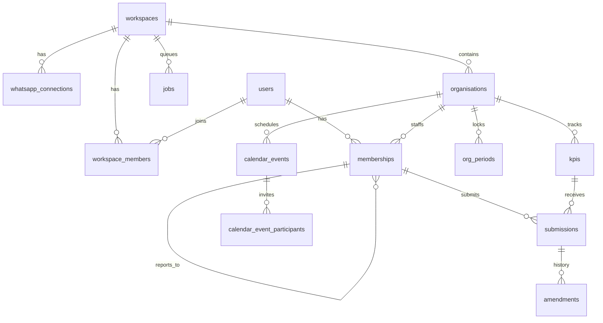

# Entity model — implemented vs planned

Cross-reference: [BUILD.md § 1.2](../BUILD.md#12-data-model), [§ 6.1–6.6](../BUILD.md#61-schema) (Phase 2), [§ 7](../BUILD.md#7-phase-3--people--units) (Phase 3).

Migrations run in order `001`–`011` (`packages/db/migrations/`). Every business row carries `workspace_id` after `010_workspaces.sql` (backfilled to the **Sona** workspace when data already existed).

## Two axes of identity

| Axis | Storage | Values today | Notes |
|------|---------|--------------|-------|
| **Workspace** | `workspaces`, `workspace_members` | Workspace roles: `owner`, `admin`, `member` | Customer boundary; RLS **restrictive** policy `ws_isolation` ([BUILD § 6.2](../BUILD.md#62-rls-restrictive-isolation--scoped-access)). |
| **Organisation membership** | `users`, `memberships` | `role_level`: `owner`, `manager`, `vice_manager`, `team_lead`, `member` | Portfolio owner has `org_id IS NULL` ([`001_schema.sql`](../../packages/db/migrations/001_schema.sql)); everyone else has one `org_id` and optional `parent_id` reporting tree. |

Login resolves a **membership** (and thus workspace) via `auth.primary_membership`, `auth.actor_for_membership` ([`010_workspaces.sql`](../../packages/db/migrations/010_workspaces.sql)). WhatsApp resolves a phone only inside the connection's workspace (`auth.actor_for_phone`).

**Phase 3+ (planned):** `units` (organisation / branch / department / team) and `assignments` replace one-membership-per-org; `memberships` becomes legacy ([BUILD § 7](../BUILD.md#7-phase-3--people--units), [phase3-people-units.md](../phase3-people-units.md)). Not in migrations yet (DDL sketch: [`012_phase3_units_assignments.sql.sketch`](../../packages/db/migrations/012_phase3_units_assignments.sql.sketch)).

---

## Workspace (implemented)

```
workspaces (id, name, slug UNIQUE, timezone, currency, plan, status)
workspace_members (workspace_id, user_id, workspace_role, status) PK (workspace_id, user_id)
whatsapp_connections (id, workspace_id, connector_id UNIQUE, linked_phone_e164, status)
```

- Composite uniqueness: `UNIQUE (workspace_id, id)` on workspace-scoped entities ([BUILD § 3](../BUILD.md#3-conventions)).
- Child FKs are composite `(workspace_id, foreign_id) → parent (workspace_id, id)` on tables touched in `010`.
- `memberships` also FK `(workspace_id, user_id) → workspace_members` so a person must be a workspace member.

**Commercial (Phase 8):** `plans`, `workspace_entitlements`, `workspace_usage_daily`, `workspace_export_jobs`, `workspace_deletion_requests` — see migration `020_commercial.sql`.

**Expansion (Phase 9):** `task_dependencies`, `project_templates`, `attachments`, `saved_views`, `calendar_integrations`, `calendar_sync_log`, `billing_customers`; `tasks.estimate_hours` — see migration `021_expansion.sql`. Production OAuth/Stripe/CDN deferred per [PHASE9_EXIT.md](../PHASE9_EXIT.md).

---

## Organisation (implemented → evolves in Phase 3)

```
organisations (workspace_id, id, slug, name, short_name, sector, descriptor, …)
```

- Slug unique per workspace (`organisations_ws_slug_key`), not globally.
- `org_links`, `profile_sections`, `case_studies`, `partnerships`, `revenue_lines` hang off `org_id` (all workspace-scoped).

**Phase 3 planned:** each legacy organisation becomes a `unit` with `type = 'organisation'` and `legacy_org_id`; tree of branches/departments/teams under `units.parent_id` ([BUILD § 7](../BUILD.md#7-phase-3--people--units)).

---

## Membership & reporting (implemented)

```
users (global email, phone_e164, password_hash, is_named, status)
memberships (workspace_id, id, user_id, org_id?, role, title, parent_id → memberships, state)
```

Constraints ([`001_schema.sql`](../../packages/db/migrations/001_schema.sql)):

- `owner` ⇒ `org_id IS NULL`, `parent_id IS NULL`.
- At most one active `manager` per org (`one_manager_per_org`).

`state`: `active`, `pending_name`, `inactive` (`member_state` enum).

Reporting tree: `parent_id` on `memberships`; used for activity visibility (RLS subtree on `activity_entries`) and team-lead submission review (see [states-submissions.md](./states-submissions.md)).

**Phase 3 planned mapping** ([BUILD § 7](../BUILD.md#7-phase-3--people--units)):

| Today `role_level` | Planned assignment `role` |
|--------------------|---------------------------|
| `owner` | workspace owner (not an assignment) |
| `manager` | `unit_manager` |
| `vice_manager` | `unit_deputy` |
| `team_lead` | `team_lead` |
| `member` | `contributor` |

---

## KPI register & scoring (MVP — Phase 6 replaces with ledger)

```
kpis, kpi_goals, kpi_audit, submissions, amendments, org_periods, signoffs, scores
activity_entries, escalations
```

- One submission per `(kpi_id, period_date, level)` where `level` = submitter's `role_level` at record time.
- Period lock: `org_periods (org_id, period_date, status open|locked, locked_by, reopened_*)` ([`007_org_periods.sql`](../../packages/db/migrations/007_org_periods.sql)).
- `signoffs` kept for compatibility when locking a day ([BUILD § 4.4](../BUILD.md#44-f4-period-lock)).
- Scoring reads highest-level `validated` / `locked` submission per day (`packages/api/src/scoring.js`).

**Phase 6 planned:** `metrics`, `target_versions`, `reports`, `report_revisions`, `approvals`, `ledger_entries`, `period_results` — see [BUILD § 10](../BUILD.md#10-phase-6--targets--measurement-ledger). Legacy tables archived under schema `legacy`.

---

## Calendar event (implemented, Phase 2 scope)

```
calendar_events (workspace_id, id, org_id?, title, kind, starts_at, ends_at, all_day, …, created_by → memberships)
calendar_event_participants (workspace_id, event_id, membership_id, response)
```

- No `project_id` yet ([BUILD § 6.6](../BUILD.md#66-calendar--events) adds it in Phase 5).
- Participants reference **membership** ids, not bare `user_id` (implementation choice).
- Reminders enqueue `jobs` with kind `event_reminder` (`011_jobs_calendar.sql`, `packages/api/src/modules/calendar.js`).

Derived calendar items (days awaiting lock) are computed in the feed, not stored.

---

## Jobs (implemented, Phase 2)

```
jobs (workspace_id, id bigserial, kind, payload jsonb, run_at, attempts, locked_by, done_at, failed_at, dedupe_key)
```

- Claim/finish via `auth.claim_jobs`, `auth.enqueue_job` (definer functions in `011`).
- RLS: worker reads with `app.role = 'system'`; app code enqueues under user scope.

**Used for:** event reminders, digest hooks in routes; broader notification/digest surface in later phases ([BUILD § 6.5](../BUILD.md#65-job-queue)).

---

## Submission (entity summary)

Logical entity backed by `submissions` + `amendments` + `org_periods`. Full state machine: [states-submissions.md](./states-submissions.md).

---

## Agent & WhatsApp

| Table | Role |
|-------|------|
| `agent_sessions`, `agent_tool_calls`, `agent_pending_confirms` | Chat/agent turns per membership |
| `wa_outbox`, `wa_auth_state` | Outbound messages; sidecar auth (workspace-scoped outbox after `010`) |

---

## ER sketch (implemented core)



---

## Table inventory (migrations 001–011)

| Migration | Adds / changes |
|-----------|----------------|
| `001` | Core enums, organisations, users, memberships, KPI stack, submissions, scores, agent/WA tables |
| `002` | Initial RLS on submissions, activity, kpis, scores |
| `003`–`006` | Cadence goals, roles, bands |
| `007` | `org_periods`, amendments `ON DELETE CASCADE` |
| `008` | `auth.*` definer lookups |
| `009` | Force RLS, `app_global()` / org policies |
| `010` | `workspaces`, composite FKs, workspace RLS |
| `011` | `jobs`, `calendar_events`, participants, job auth functions |

**Count:** 28 workspace-scoped business tables in production schema (23 from BUILD § 1.2 baseline plus `workspaces`, `workspace_members`, `whatsapp_connections`, `org_periods`, `jobs`, `calendar_events`, `calendar_event_participants`; `kpi_goals` from `006`).
