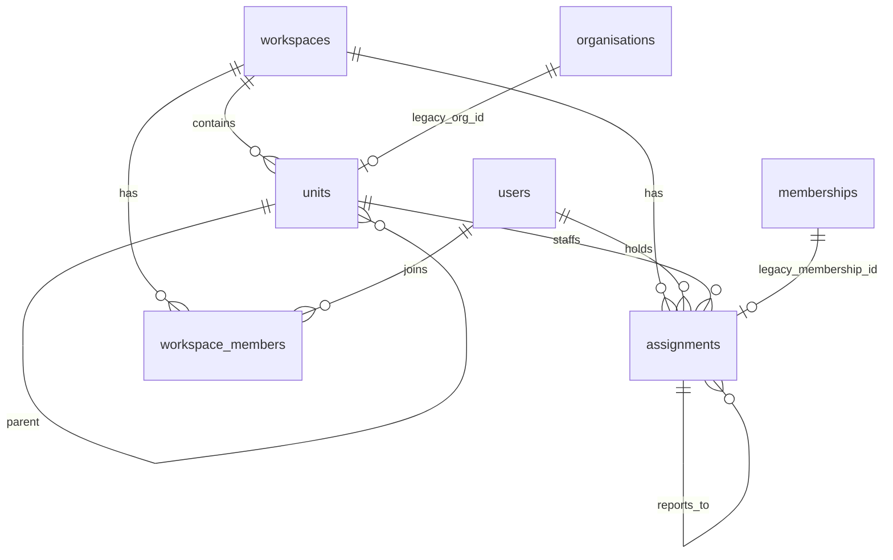

# Phase 3 prep — People & units

**Status:** Local engineering gate — [PHASE3_EXIT.md](./PHASE3_EXIT.md) (migrations `012`–`014`, `POST /assignments` secondaries, exit-gate test)  
**Audience:** Sona, second pilot, engineering  
**Normative spec:** [BUILD.md § 7](./BUILD.md#7-phase-3--people--units) · **Gate:** [ROADMAP.md § Phase 3](./ROADMAP.md#phase-3--people--units)  
**As-built baseline:** [docs/model/entities.md](./model/entities.md) · [docs/model/permissions-matrix.md](./model/permissions-matrix.md)

---

## Implementation status (local slice)

| Item | State | Notes |
|------|--------|-------|
| `012_units_assignments.sql` + verify | **Done** | `units`, `assignments`, `invitations`; type trigger; RLS (`ws_isolation` + org-scoped visibility); backfill via `auth.sync_units_from_legacy()` (`assignments.id = memberships.id`) |
| `GET /units`, `GET /units/tree` | **Done** | `packages/api/src/modules/units.js` → `listUnitTree` (owner = full tree; manager = own org unit in this slice) |
| `tests/integration/units.test.js` | **Done** | 4 tests: backfill parity, workspace isolation, manager scope, owner tree |
| `memberships` write freeze | **Deferred** | Legacy table stays writable; KPI FKs unchanged |
| People / Organisations UI | **Partial** | `/people`: unit tree, invites, owner/manager unit create + rename (POST/PATCH `/units`) |
| Invitation HTTP + accept flow | **Done** | `POST/GET /invitations`, public `POST /invitations/:id/accept` (token + workspace_id); `packages/api/src/domain/invitations.js` |
| Agent tools (`list_units`, …) | **Partial** | `list_units` on catalogue + `portfolio_os` dispatch; no ADK edits |
| Dual-write people mutations | **Done** | `addPerson` / `updatePerson` / `removePerson` + `GET /orgs/:slug/people` assignment fields; `assignment-sync.js` |
| `tests/integration/invitations.test.js` | **Done** | Create, list, accept, permissions |
| People assignments integration | **Done** | Extended `tests/integration/units.test.js` |
| `reconcile/012_units_assignments.sql` | **Deferred** | Follow 010 pattern before production cutover |

After `npm run seed`, `auth.sync_units_from_legacy()` runs so Sona-shaped data matches units/assignments without re-migrating.

---

## 1. Goal

Introduce a **typed unit tree** (`organisation` → `branch` → `department` → `team`) and **assignments** (many per person, one primary) while **preserving** today’s reporting lines, workspace isolation, and all KPI/submission/calendar behaviour that still keys off `organisations` and `memberships`.

Phase 3 delivers customer-editable structure, invitations, and **Organisations** / **People** screens in the § 14 design system ([BUILD § 14.4](./BUILD.md#144-screens-and-migration-order)). Permissions stay on Phase 0 rules until Phase 4 `can()` ([permissions-matrix.md](./model/permissions-matrix.md)).

---

## 2. Schema delta — current vs target

### 2.1 What exists today

See [entities.md § Organisation](./model/entities.md#organisation-implemented--evolves-in-phase-3) and [§ Membership & reporting](./model/entities.md#membership--reporting-implemented).

| Concern | Tables | Notes |
|---------|--------|-------|
| Org register | `organisations` | Workspace-scoped slug; profile children (`org_links`, `profile_sections`, …) hang off `org_id`. |
| Person ↔ org | `memberships` | One `org_id` per non-owner; `role_level` enum; `parent_id` reporting tree; `state` includes `pending_name`. |
| Workspace access | `workspaces`, `workspace_members` | Owner membership ⇒ `workspace_role = 'owner'`. |
| Session / actor | `auth.primary_membership`, `auth.actor_for_membership` | JWT still carries **membership** id ([`010_workspaces.sql`](../packages/db/migrations/010_workspaces.sql)). |

Downstream FKs still point at **`memberships.id`** (not `user_id`): KPI `owner_id`, `submissions.submitted_by`, `calendar_event_participants.membership_id`, agent sessions, activity log, etc. ([entities.md](./model/entities.md) inventory).

### 2.2 What Phase 3 adds (BUILD § 7)

Normative DDL sketch:

```sql
-- See BUILD § 7 for full CREATE TABLE statements
unit_type: organisation | branch | department | team
units (workspace_id, parent_id, type, name, …, legacy_org_id UNIQUE)
assignments (workspace_id, user_id, unit_id | project_id, role, reports_to, is_primary, status, …, legacy_membership_id UNIQUE)
invitations (workspace_id, email/phone, role, unit_id, token_hash, expires_at, accepted_at, …)
```

Composite keys everywhere: `UNIQUE (workspace_id, id)` and composite FKs ([BUILD § 3](./BUILD.md#3-conventions), [entities.md § Workspace](./model/entities.md#workspace-implemented)).

| New | Replaces / parallels | Deliberate non-goals in Phase 3 |
|-----|----------------------|----------------------------------|
| `units` tree | Flat `organisations` for **structure** | Do **not** drop `organisations` yet — KPI register, `org_periods`, scores, and profile tables keep `org_id` until a later phase retargets them. |
| `assignments` | Single `memberships.org_id` | `project_id` on assignments is nullable until Phase 5 FK is added ([BUILD § 7](./BUILD.md#7-phase-3--people--units), [§ 9](./BUILD.md#9-phase-5--projects--my-work)). |
| `invitations` | Placeholder users (`is_named = false`, `pending_name`) | Remove “Associate N” pattern from live roster UX; gate says **no placeholders in schema** ([ROADMAP exit gate](#7-exit-gate-roadmap)). |

### 2.3 Role mapping

From [entities.md](./model/entities.md#membership--reporting-implemented) / BUILD § 7:

| Today `memberships.role` (`role_level`) | Target |
|----------------------------------------|--------|
| `owner` | `workspace_members.workspace_role = 'owner'` — **not** an assignment row |
| `manager` | `assignments.role = 'unit_manager'` |
| `vice_manager` | `unit_deputy` |
| `team_lead` | `team_lead` |
| `member` | `contributor` |

Assignment `role` strings come from the Phase 1 matrix ([BUILD § 8](./BUILD.md#8-phase-4--scoped-permissions)); until Phase 4, HTTP/agent continue ad hoc checks mapped from these roles ([permissions-matrix.md § People](./model/permissions-matrix.md#people--org-profile)).

### 2.4 Unit type rules

Enforced in DB trigger + service ([BUILD § 7](./BUILD.md#7-phase-3--people--units)):

| Child type | Allowed parent types |
|------------|----------------------|
| `organisation` | (root under workspace) |
| `branch` | `organisation` |
| `department` | `organisation`, `branch` |
| `team` | `organisation`, `branch`, `department` |

Sibling names unique per parent (`units_sibling_name` index in BUILD).

### 2.5 ER after Phase 3 (logical)



`organisations` and `memberships` remain for legacy FK paths during transition; new people/structure features read/write through `units` / `assignments` / `invitations` per cutover steps below.

---

## 3. Migration strategy — organisations → units, memberships → assignments

### 3.1 Principles

1. **Workspace-safe:** every inserted row carries the source row’s `workspace_id`; reconciliation scripts per workspace ([BUILD § 3](./BUILD.md#3-conventions), pattern from Phase 2 `reconcile/0xx_workspaces.sql` in [BUILD § 6.9](./BUILD.md#69-migration-and-reconciliation)).
2. **Preserve reporting:** `memberships.parent_id` → `assignments.reports_to` via id map (see § 3.3).
3. **Preserve stable actor ids for KPI stack:** prefer **`assignments.id = memberships.id`** on backfill so existing `memberships` FKs remain valid without rewriting `kpis`, `submissions`, `calendar_event_participants`, etc. *Product/engineering must confirm* (§ 8).
4. **Owner row:** migrate portfolio owner to `workspace_members.workspace_role = 'owner'` only; no assignment for owner role.
5. **Placeholders:** rows with `users.is_named = false` and/or `memberships.state = 'pending_name'` become **`invitations`** (not active assignments); deactivate or omit matching assignment rows ([BUILD § 7](./BUILD.md#7-phase-3--people--units)).
6. **Cutover:** reads for People/Units/Invitations move to new tables; **`memberships` write-frozen** (trigger or revokes) after dual-write window; optional read-only view `memberships_compat` joining assignments for debugging.

### 3.2 Phased rollout (recommended)

| Step | Migration / app | Risk control |
|------|-----------------|--------------|
| **3.0** | `012_*` DDL: enums, `units`, `assignments`, `invitations`, RLS `ws_isolation`, indexes, type trigger | Empty tables; no app change. |
| **3.1** | Data backfill in same migration transaction | Counts + reporting integrity checks (§ 3.4). |
| **3.2** | API dual-write: people mutations write `assignments` (+ sync row to `memberships` if ids differ) | Feature flag per workspace. |
| **3.3** | Switch reads: `GET /people`, org tree, search people scope | Parity tests vs pre-migration snapshots. |
| **3.4** | Freeze `memberships` writes; retire `pending_name` enum usage for new rows | Readiness/overview counts use invitations. |
| **3.5** | Auth helpers: `auth.primary_assignment`, extend `actor_for_*` to load assignment roles | JWT may still expose `membership_id` = assignment id during compatibility window. |

Rollback: forward-only migration; rollback = restore pre-`012` dump (same as Phase 2 rehearsal). Keep `legacy_org_id` / `legacy_membership_id` for idempotent re-runs.

### 3.3 Backfill algorithm (sketch)

**Units**

1. For each `organisations` row in workspace `W`, insert `units` with `type = 'organisation'`, copy `name`, `short_name`, `status`, `legacy_org_id = organisations.id`, `parent_id = NULL`.
2. *Optional product call:* if `organisations.is_department = true`, create an extra `department` child under the accountable org, or map the org row to `department` type instead of `organisation` (§ 8.1).
3. No automatic branch/team nodes unless seed data defines them — Sona structure starts flat (one unit per legacy org) unless customer adds branches in UI.

**Assignments (pass 1 — rows)**

For each `memberships` row where `role <> 'owner'` and `state <> 'inactive'` and user is named:

- `id` ← `memberships.id` (recommended)
- `workspace_id`, `user_id` from membership
- `unit_id` ← unit where `legacy_org_id = memberships.org_id`
- `role` ← mapped string from § 2.3
- `status` ← map `active` → `active`, else `inactive`
- `is_primary` ← `true` if this is the user’s only active org membership in `W`, else `false` (secondaries created manually post-migration)
- `legacy_membership_id` ← `memberships.id`
- `reports_to` ← NULL temporarily

Owner: ensure `workspace_members.workspace_role = 'owner'` for `memberships.role = 'owner'`.

**Assignments (pass 2 — reporting)**

1. Build map `M: membership_id → assignment_id` (identity map if ids preserved).
2. For each row with non-null `parent_id`, set `reports_to = M(parent_id)` with composite FK `(workspace_id, reports_to)`.

Validate: no cycles; every non-manager role has `reports_to` consistent with old tree; at most one `unit_manager` per organisation unit (replaces `one_manager_per_org` on memberships).

**Invitations**

For each placeholder (`is_named = false` OR `state = 'pending_name'`):

- Create `invitations` with intended `role`, `unit_id`, email from `users.email`, `accepted_at` NULL.
- Set `memberships.state = 'inactive'` (or archive) and do **not** create an active assignment.

### 3.4 Reconciliation queries (outline)

Ship `packages/db/reconcile/012_units_assignments.sql` (pattern [BUILD § 6.9](./BUILD.md#69-migration-and-reconciliation)):

| Check | Expected |
|-------|----------|
| Org count | `count(organisations)` = `count(units WHERE type = 'organisation')` per workspace |
| Active people | Active non-owner memberships = active assignments with non-null `unit_id` |
| Reporting | Every `parent_id` edge has matching `reports_to` edge |
| Managers | ≤1 active `unit_manager` per organisation unit |
| Primary | ≤1 `is_primary` active assignment per user per workspace |
| Placeholders | Zero active assignments for users with `is_named = false`; invitation row exists |
| Workspace FK audit | No null `workspace_id`; composite FK test ([BUILD § 6.3](./BUILD.md#63-composite-foreign-keys)) |

### 3.5 Comment-only migration stub

For DDL review without applying:

- [`packages/db/migrations/012_phase3_units_assignments.sql.sketch`](../packages/db/migrations/012_phase3_units_assignments.sql.sketch) — commented outline mirroring BUILD § 7 and § 3.3 steps.

---

## 4. API & modules

Target layout ([BUILD § 2.1](./BUILD.md#21-repository-layout)):

```
packages/api/src/modules/
  units/     routes.js · service.js · queries.js · tools.js   ← new
  people/    routes.js · service.js · queries.js · tools.js   ← extract from domain/people.js
```

### 4.1 New / moved routes (indicative)

| Area | Today | Phase 3 |
|------|-------|---------|
| Unit tree | `GET /orgs`, `GET /orgs/:slug` (organisations) | `GET /units`, `GET /units/:id`, `GET /units/tree` — legacy slug via `legacy_org_id` or redirect |
| Unit CRUD | — | `POST/PATCH/DELETE /units` (type rules, deactivate not delete if referenced) |
| People list | `GET /orgs/:slug/people` | `GET /units/:id/people` **and** keep slug route as alias during transition |
| People CRUD | `POST /orgs/:slug/people`, `PATCH/DELETE /people/:id` | Same paths + assignment-centric payloads (`unit_id`, `reports_to`, `role`, `is_primary`) |
| Invitations | — | `POST /invitations`, `POST /invitations/:id/resend`, `POST /invitations/accept` (public token) |
| Account | profile in legacy `page.js` | Password reset, ownership transfer, deactivate assignment ([ROADMAP](./ROADMAP.md#phase-3--people--units)) |
| Search | BUILD `GET /search?...&in=people` | People hits resolve assignment + unit labels ([BUILD § 6.8](./BUILD.md#68-search)) |

Implementation notes:

- Keep `packages/api/src/domain/org-access.js` until KPI routes retarget; units module owns structure mutations.
- `core/context`: load `actor.assignments[]` from DB (BUILD § 8 actor shape) even before `can()` lands.
- Errors: migrate people domain to `DomainError` when touching files ([BUILD § 3](./BUILD.md#3-conventions)).

### 4.2 Agent tools ([AGENTS.md](../AGENTS.md))

Add catalogue actions (implement in `packages/api` only — **do not** extend ADK enums):

| Tool | Purpose |
|------|---------|
| `list_units`, `show_unit` | Tree navigation |
| `create_unit`, `update_unit`, `archive_unit` | Structure edits |
| `list_assignments`, `add_assignment`, `update_assignment`, `end_assignment` | Cross-unit work |
| Extend `add_person` / `update_person` / `list_people` | Accept `unit_id`, assignment roles |

Playbook copy lives in API catalogue, not ADK.

### 4.3 Auth functions to extend

| Function | Change |
|----------|--------|
| `auth.primary_membership` | Select primary via `assignments.is_primary` or highest assignment role; return stable id (= assignment id). |
| `auth.actor_for_membership` | Join `assignments` + `units` for org slug/name; keep column names for API compatibility. |
| `auth.actor_for_phone` | Resolve user → primary assignment in connection workspace. |

WhatsApp and JWT compatibility depend on id preservation (§ 3.1).

---

## 5. Web — Organisations & People screens

From [BUILD § 14.4](./BUILD.md#144-screens-and-migration-order) and [ROADMAP](./ROADMAP.md#phase-3--people--units):

| Route | UX |
|-------|-----|
| `app/(app)/orgs` | **Organisations:** expandable tree (org → branches → teams → people counts); detail panel for unit metadata; actions gated like today’s `update_org` ([permissions-matrix](./model/permissions-matrix.md#people--org-profile)). |
| `app/(app)/people` | **People:** workspace roster; filters by unit, role, status; detail shows primary vs secondary assignments, reports-to, invitation state. |
| Legacy | `app/page.js` Team tab remains under `legacy/` until parity sign-off. |

Data: `lib/api.js` wrappers for new endpoints; list rows use `ListRow` / `DetailPanel` ([BUILD § 14.3](./BUILD.md#143-components-componentsapp)).

Calendar people picker today calls `GET /orgs/:slug/people` ([`apps/web/app/calendar/page.js`](../apps/web/app/calendar/page.js)) — switch to unit-scoped list or workspace people endpoint with RLS-safe visibility (same rule as [calendar.js](../packages/api/src/modules/calendar.js) membership picker).

---

## 6. Test plan outline (transition parity)

### 6.1 Database / migration

- Apply `012` on copy of production-like dump; run `reconcile/012_units_assignments.sql`; zero failures.
- Reporting tree isomorphism: compare adjacency lists memberships vs assignments.
- Constraint tests: invalid unit parent/type rejected; second primary assignment rejected.

### 6.2 API integration (extend `tests/integration/`)

| Suite | Assert |
|-------|--------|
| **People parity** | Same roster count and roles vs pre-migration baseline per org slug alias. |
| **Reporting** | Team-lead subtree for approvals unchanged ([states-submissions.md](./model/states-submissions.md), RLS `subtree_scope`). |
| **People mutations** | `add_person` / `update_person` / `remove_person` HTTP + agent tools — same forbidden cases as [permissions-matrix](./model/permissions-matrix.md#people--org-profile). |
| **Manager uniqueness** | Cannot create second `unit_manager` on same organisation unit. |
| **Cross-unit** | User with branch manager + contributor assignment elsewhere ([exit gate](#7-exit-gate-roadmap)). |
| **Invitations** | Placeholder seed users become invitations; readiness no longer counts `pending_name` memberships ([`GET /readiness`](../packages/api/src/routes.js)). |
| **Calendar** | Participant picker only lists visible people; events created before/after migration. |
| **Auth** | Login, workspace switch, `auth.actor_for_phone` for seeded phones. |

### 6.3 Regression on untouched features

Submissions, lock/reopen, scoring, overview, KPI CRUD, escalations — **no behavioural change**; run existing integration suites without modification where possible.

### 6.4 Manual / pilot

- Sona edits structure (add branch, move team), invites a real user, accepts invitation.
- Manager adds secondary assignment for cross-branch contributor scenario (exit gate).

---

## 7. Exit gate (ROADMAP)

From [ROADMAP.md § Phase 3](./ROADMAP.md#phase-3--people--units):

> **Exit gate:** one person manages a branch and contributes to a team in another branch; Sona's structure has no placeholders in the schema; existing features unaffected.

Engineering checks:

1. Demo user holds **two active assignments** in different branches (manager on one, contributor on another).
2. Seed has **zero** `pending_name` memberships and no roster UX depending on unnamed placeholders — invitations only.
3. Full integration suite green; KPI/submission/calendar paths unchanged for Sona workspace.

---

## 8. Product input queue

Decisions needed before freezing `012` DDL and API contracts:

| # | Topic | Options / notes |
|---|--------|-----------------|
| 8.1 | `organisations.is_department` | Map to `department` unit under parent org vs treat as full `organisation` unit (today all orgs are peers in UI). |
| 8.2 | Assignment id strategy | **Recommended:** `assignments.id = memberships.id` for FK stability vs new ids + long-running dual tables. |
| 8.3 | `organisations` table lifecycle | Keep as KPI/register anchor through Phase 6 vs start dual-writing `unit_id` on KPIs in Phase 3. |
| 8.4 | Slug in URLs | Keep `/orgs/:slug` forever as alias to organisation unit vs redirect to `/units/:id`. |
| 8.5 | `workspace_role = 'admin'` | Distinct structure-edit powers before Phase 4 matrix? |
| 8.6 | Manager / deputy constraints | Per **organisation unit only**, or per branch/team as well? (Today: one manager per org.) |
| 8.7 | Secondary assignments | Can a user have two primaries if in two workspaces only — confirm single primary **per workspace**. |
| 8.8 | Invitation channel | Email-only vs email + WhatsApp deep link; password set on accept vs magic link. |
| 8.9 | Ownership transfer | Move `workspace_role` only vs also reassign unit_manager assignment. |
| 8.10 | Deactivate person | End all assignments vs primary only; effect on KPI `owner_id` and open submissions. |
| 8.11 | Cross-unit exit demo | Which Sona branches/teams to seed for the gate scenario. |

Prior open items from [model/README.md product queue](./model/README.md#product-review-queue-needs-sona-sign-off) still apply to people **permissions** until Phase 4.

---

## 9. Related documents

| Doc | Link |
|-----|------|
| Entity model (implemented vs planned) | [docs/model/entities.md](./model/entities.md) |
| Permission matrix (Phase 0) | [docs/model/permissions-matrix.md](./model/permissions-matrix.md) |
| Submission / RLS subtree | [docs/model/states-submissions.md](./model/states-submissions.md) |
| BUILD Phase 3 DDL | [BUILD.md § 7](./BUILD.md#7-phase-3--people--units) |
| ROADMAP scope & duration | [ROADMAP.md](./ROADMAP.md) (Phase 3 — 2 weeks) |

---

*Last updated: 12 Nov 2026 — invitations HTTP, people dual-write, `list_units` tool.*
